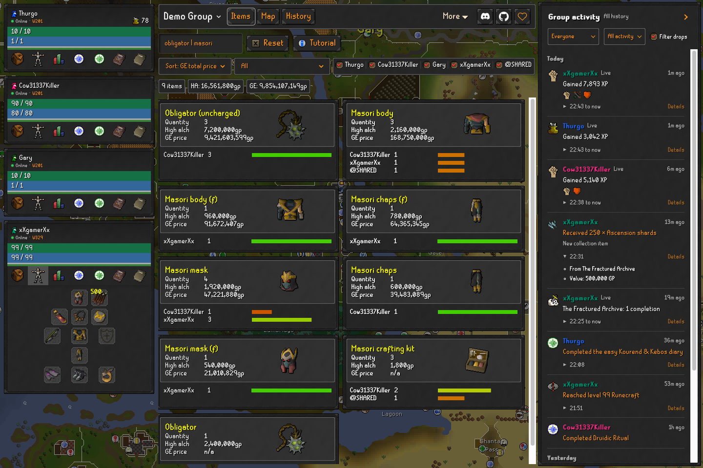
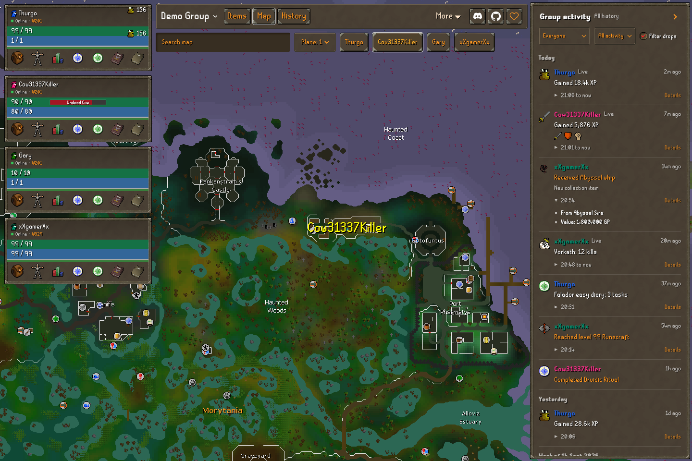
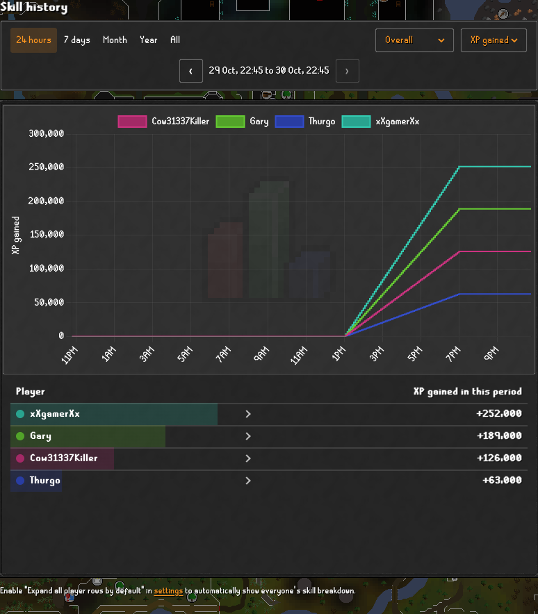
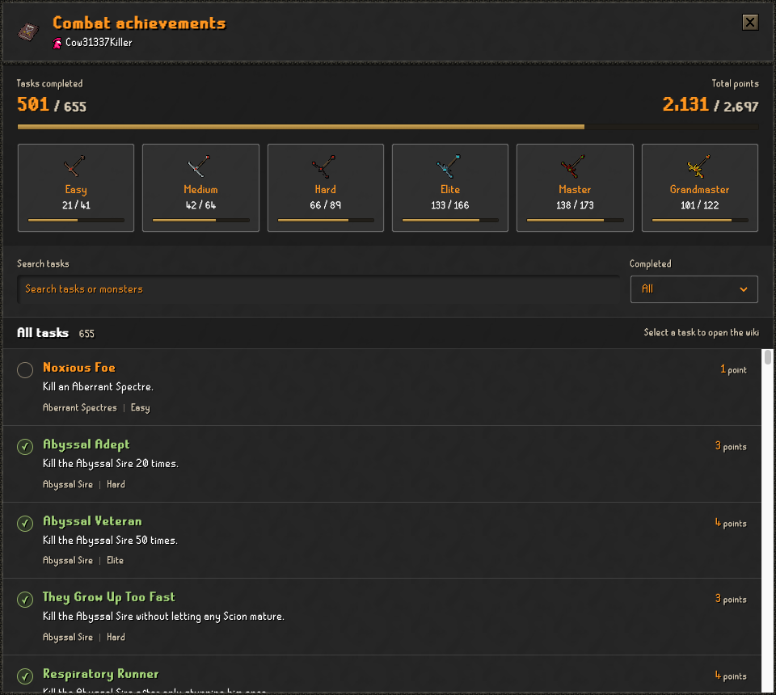
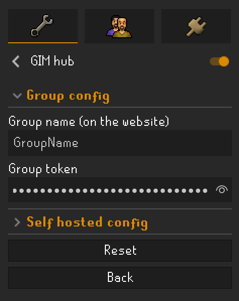

# GIM Hub

Your teammate just got a drop. Someone else is closing in on 99. GIM Hub brings your Old School RuneScape Group Ironman team together in one live dashboard, so you can keep up with the grind and find the gear your group needs.

[Try the demo](https://gim-hub.com/demo) · [Get started](https://gim-hub.com/create-group) · [Changelog](https://gim-hub.com/changelog) · [Discord](https://discord.gg/ZwzW6yYD8V)

_Screenshots use sample data from the demo._

## Keep up with the group

The RuneLite plugin updates the dashboard as your teammates play. See who is online, their worlds, current interactions, local times, and when they were last online. Player panels show health, prayer, run energy, special attack energy, and live XP drops.

Follow XP gains, levels, boss kills, raid completions, quests, diaries, drops, and collection log unlocks in the activity timeline. Filter by teammate or activity type, expand entries for details, and catch up on older history through weekly summaries.

## Find the gear you need

Search your whole group's items, with quantities by member and storage location, plus Grand Exchange and high alchemy values. Pin useful items, filter by teammate or container, and copy your filtered items to **Gearscape** by enabling its export button in appearance settings.

Search by name or `tag:`, use quotes for exact names, and combine searches with `&`, `|`, `-`, and square brackets. For example, `bandos | whip` finds either, while `coal & -bag` leaves out coal bags.

See every supported container and storage location

- **Everyday storage:** Bank, shared bank, inventory, equipment, quiver, rune pouch, seed vault, and potion storage.
- **Portable containers:** Plank sacks, master scroll books, essence pouches, tackle boxes, coal bags, fish barrels and fish sack barrels, herb sacks, looting bags, seed boxes, gem bags and gem sacks, chugging barrels, meat pouches, fur pouches, reagent pouches, bolt pouches, log baskets, Forestry kits, huntsman's kits, bow string spools, steel key rings, Flamtaer bags, bottomless compost buckets, and gnomish firelighters.
- **POH storage:** Costume room, spice rack, pet house, and servant's moneybag.
- **Around Gielinor:** STASH units, tool leprechaun, Elnock Inquisitor, Blast Furnace ores and bars, fossil storage, balloon transport supplies, Sandstorm sand and buckets, Hallowed Sepulchre supplies, and Sailing cargo holds.
- **Coffers:** Coin balances in the Blast Furnace, Nightmare Zone, and Scar Essence Mine coffers.

## Follow your teammates across Gielinor

Find your group on the interactive world map, follow a teammate as they move, or search for a named location. Switch between floors and pinch to zoom on mobile.

## Watch the gains add up

Compare XP gained, total XP, and XP per hour across your group. Browse a day, week, month, year, or all recorded history, then expand a player's row for their skill breakdown.

## Plan the next achievement

Track quests, achievement diary tasks, and collection logs. See your group's unique collection log total, which teammates have each item, repeat drop counts, and boss kill counts.

Open **Combat achievements** from a player panel to see completed tasks, points, and progress per tier. Search by task or monster, filter by tier or completion, and open a task on the OSRS wiki.

## Make it yours

Choose light or dark mode, set member colors and display order, and toggle virtual levels and skill progress bars. You can also expand everyone's history rows by default and switch between saved groups from the group name menu.

## Getting started

1. Install **GIM Hub** from the RuneLite Plugin Hub.
2. Create a group on the [GIM Hub website](https://gim-hub.com) and copy its group token.
3. Enter the group name and token in the plugin settings in RuneLite.
4. Share the group name and token with your teammates so they can connect their plugins and open the same dashboard.

Member names on the website must match their in game display names. Open or check storage containers and coffers in game to sync their contents.

Plugin settings in RuneLite

## Self-hosting

See the [self-hosting guide](self-host.md) to run your own instance.

## Links

- [GIM Hub repository](https://github.com/wouterrutgers/gim-hub.com)
- [GIM Hub RuneLite plugin repository](https://github.com/wouterrutgers/gim-hub-plugin)
